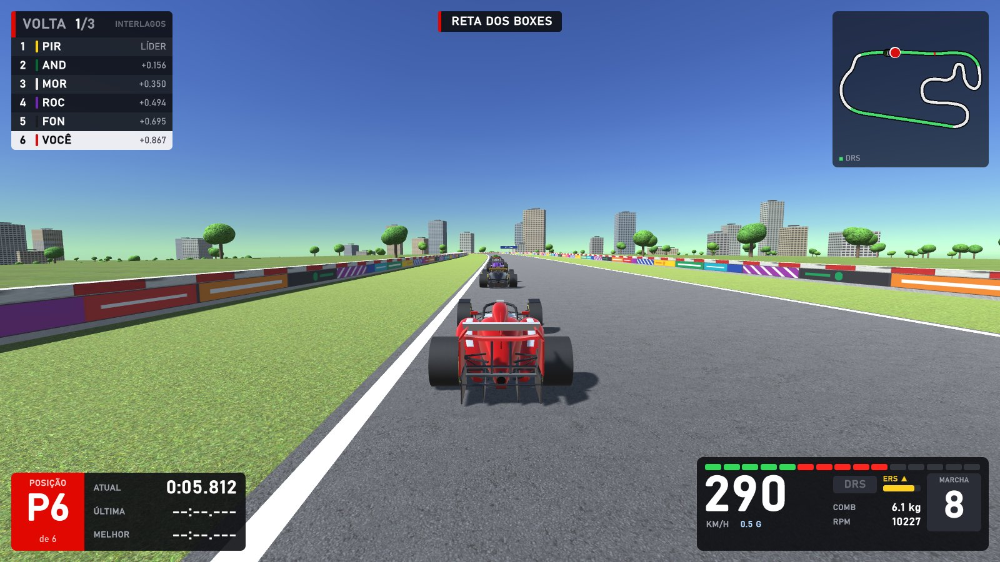
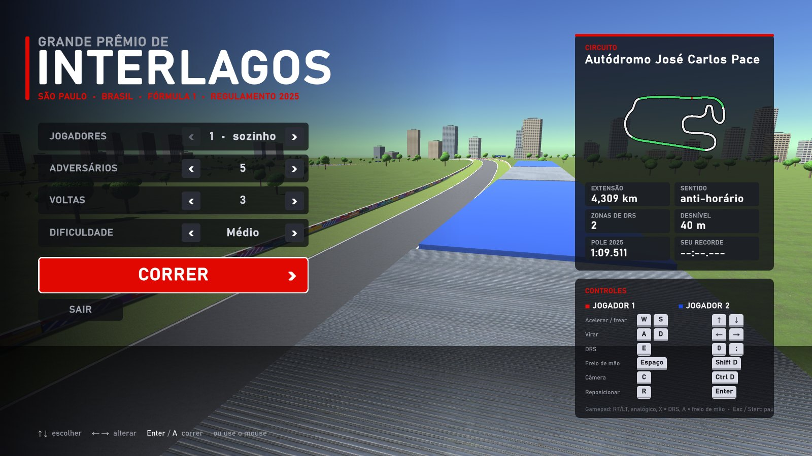
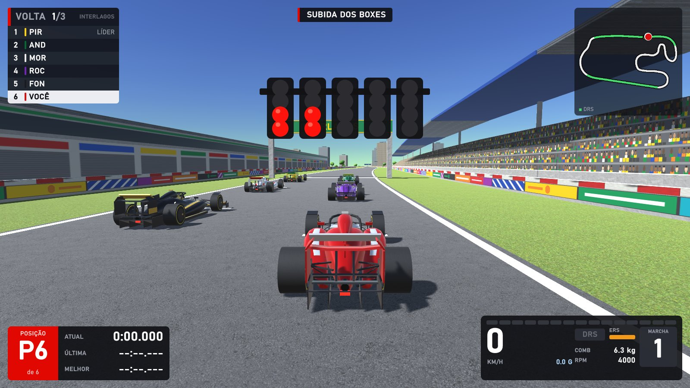
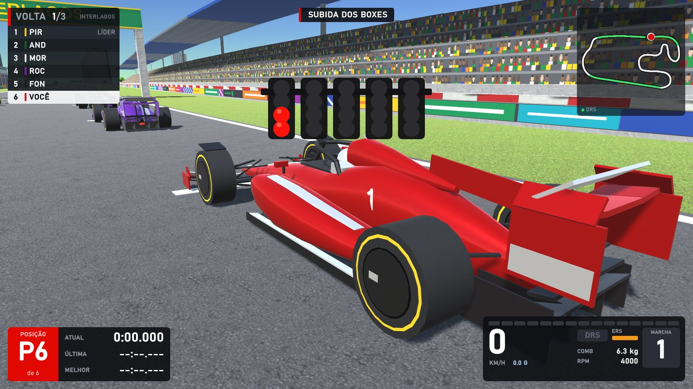
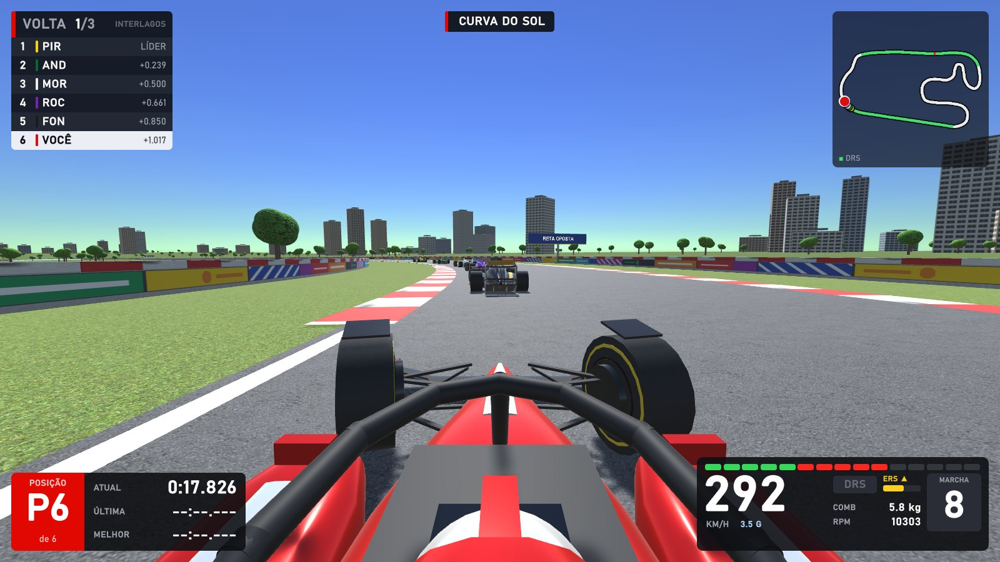
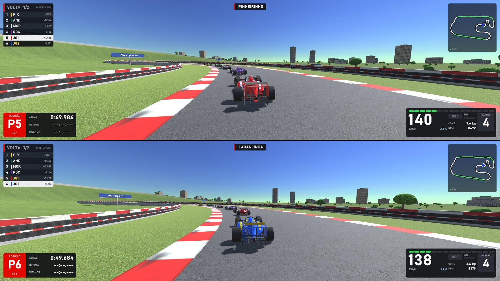
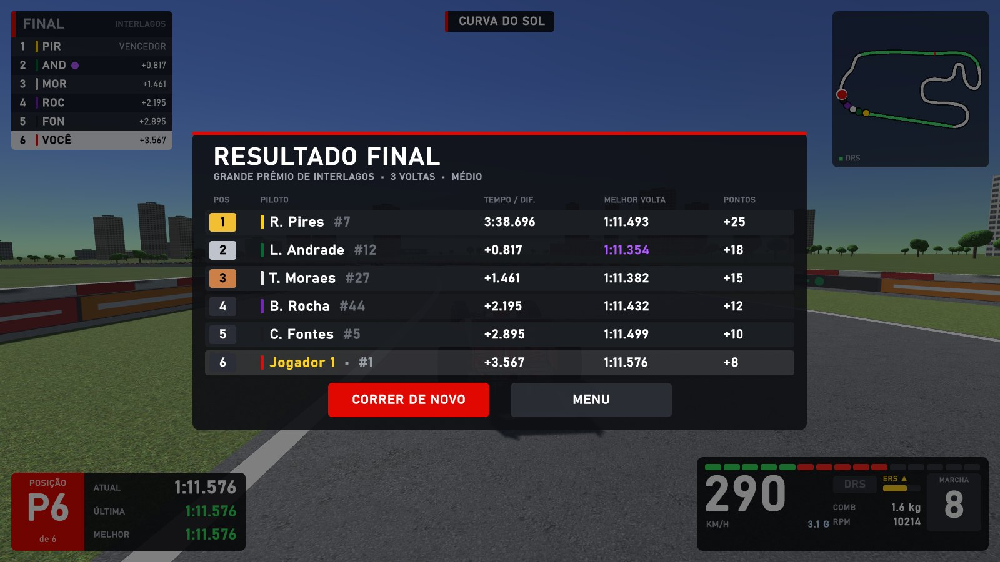

# Corrida em Interlagos

Jogo de corrida 3D feito em Unity com carros de Fórmula 1 no regulamento técnico de 2025 e uma réplica do Autódromo José Carlos Pace (Interlagos). Dá para jogar sozinho contra a IA ou em dois jogadores com tela dividida.

Todo o conteúdo do jogo é gerado por código na hora em que ele abre: a pista, o cenário, os carros, os materiais, o som do motor e a interface. A cena do Unity fica vazia.



## Imagens

| Menu | Largada |
|---|---|
|  |  |

| O carro | Câmera de cockpit |
|---|---|
|  |  |

| Dois jogadores | Resultado |
|---|---|
|  |  |

## Destaques

**Pista**
- Traçado de Interlagos no sentido anti-horário, com 4.309 m e cerca de 40 m de desnível: S do Senna, Curva do Sol, Reta Oposta, Descida do Lago, Ferradura, Laranjinha, Pinheirinho, Bico de Pato, Mergulho, Junção e Subida dos Boxes.
- Zebras, muros com placas de publicidade, barreiras de pneus, arquibancadas com torcida, prédio dos boxes, pórtico de largada, lago, árvores e a cidade em volta.
- A linha ideal de corrida é calculada pelo próprio jogo e usada pela IA.

**Carro (regulamento 2025)**
- Formato da era do efeito solo: bico longo, asa dianteira de 4 elementos, sidepods em rampa, assoalho largo com difusor, asa traseira com flap do DRS móvel, halo e calotas nas rodas de 18".
- Peso mínimo de 800 kg com piloto, até 110 kg de combustível consumidos durante a corrida.
- V6 turbo com o MGU-K de 120 kW, limitado a 4 MJ de energia elétrica por volta.
- Downforce que cresce com o quadrado da velocidade e pneus que perdem eficiência com muita carga.
- Câmbio de 8 marchas com corte a 15.000 rpm e som do motor sintetizado seguindo o giro.

**Corrida**
- Largada com as cinco luzes vermelhas apagando depois de um tempo aleatório.
- DRS com as regras de 2025: liberado a partir da 3ª volta, quando o carro passa no ponto de detecção a menos de 1 s do carro da frente. Interlagos tem duas zonas, na Reta dos Boxes e na Reta Oposta.
- Até 8 carros, 1 a 71 voltas e três níveis de dificuldade para a IA.
- Pontuação de 2025 (25, 18, 15, 12, 10, 8, 6, 4, 2, 1) e recorde pessoal salvo entre as sessões.

**Interface no estilo das transmissões**
- Torre de tempos com a diferença de cada piloto para o líder, ao vivo.
- Volante digital com luzes de giro, marcha, velocidade, DRS, ERS, combustível e força G.
- Cores de cronometragem da F1: roxo para a volta mais rápida da corrida, verde para a melhor volta pessoal, amarelo para as demais.
- Menu, pausa e resultado navegáveis por mouse, teclado ou gamepad.

## Números calibrados com a realidade

Com a física padrão, a IA no nível médio faz voltas entre 1:11 e 1:12, e a volta ideal calculada fica perto de 1:10.

| | Real (2025) | No jogo |
|---|---|---|
| Pole position | 1:09.511 | ~1:10 (volta ideal) |
| Volta mais rápida na corrida | 1:12.400 | 1:11.3 a 1:12.3 (IA, nível médio) |
| Velocidade no fim da reta | em torno de 330 km/h | 328 km/h, 341 km/h com DRS |
| Aceleração lateral máxima | 5 a 6 G | até ~5,5 G |

A divisão de potência entre o motor a combustão e o elétrico, os valores de downforce e a posição exata das zonas de DRS são estimativas feitas a partir de fontes públicas.

## Controles

| Ação | Jogador 1 | Jogador 2 | Gamepad |
|---|---|---|---|
| Acelerar / frear | W / S | ↑ / ↓ | RT / LT |
| Virar | A / D | ← / → | Analógico esquerdo |
| Abrir o DRS | E | 0 do teclado numérico ou ; | X |
| Freio de mão | Espaço | Shift direito | A |
| Trocar câmera | C | Ctrl direito | B |
| Voltar para a pista | R | Enter | Y |
| Pausa | Esc | Esc | Start |

No menu, use as setas para escolher e alterar as opções e Enter para correr.

## Como rodar

1. Instale o Unity **6000.6.9f1** (Unity 6) pelo Unity Hub, com o módulo de build para Windows.
2. Abra esta pasta como projeto no Unity Hub. O Unity vai gerar a pasta `Library` na primeira abertura.
3. Abra a cena `Assets/Scenes/Interlagos.unity` e aperte Play, ou use o menu **Corrida → Gerar executável (Windows)** para criar `Build/CorridaInterlagos.exe`.

Também dá para gerar o executável pela linha de comando:

```powershell
& "C:\Program Files\Unity\Hub\Editor\6000.6.9f1\Editor\Unity.exe" -batchmode -quit `
  -projectPath "$PWD" -executeMethod ProjectSetup.BuildWindows -logFile build.log
```

O executável aceita `-capturas <pasta>` para rodar um teste automático: o jogo dirige sozinho, corre uma prova de 3 voltas e outra em tela dividida, salva capturas de tela e registra no log os tempos de volta, as velocidades máximas e as saídas de pista.

## Estrutura do código

| Arquivo | O que faz |
|---|---|
| `Assets/Scripts/TrackData.cs` | Traçado de Interlagos (spline), linha ideal, velocidades-alvo e zonas de DRS |
| `Assets/Scripts/TrackBuilder.cs` | Malha da pista, zebras, muros, terreno e cenário |
| `Assets/Scripts/CarController.cs` | Especificações de 2025 (`F1Spec`) e a física do carro |
| `Assets/Scripts/CarFactory.cs` | Modelo 3D do carro gerado por seções transversais |
| `Assets/Scripts/AIDriver.cs` | Pilotos da IA: linha ideal, frenagem, ultrapassagem e DRS |
| `Assets/Scripts/RaceManager.cs` | Largada, voltas, posições, cronometragem, DRS e ERS |
| `Assets/Scripts/RaceUI.cs` | Menu, HUD, pausa e resultado |
| `Assets/Scripts/GameInput.cs` | Teclado (sistema antigo e novo) e gamepads |
| `Assets/Scripts/ChaseCamera.cs` | Câmeras perto, longe e cockpit |
| `Assets/Scripts/EngineAudio.cs` | Som do V6 sintetizado |
| `Assets/Scripts/Util.cs` | Materiais, texturas procedurais e utilitários de física |
| `Assets/Editor/` | Criação da cena, biblioteca de materiais e build |

## Créditos

- Texturas fotográficas de asfalto, grama, concreto, terra, casca de árvore, metal e borracha: [ambientCG](https://ambientcg.com), licença CC0. As demais texturas são geradas pelo projeto.
- Dados de referência: regulamento técnico da FIA de 2025, Pirelli (medidas dos pneus) e resultados oficiais do Grande Prêmio de São Paulo de 2025.

Projeto pessoal, sem ligação com a Formula 1, a FIA ou as equipes. As pinturas, os nomes de pilotos e as placas de publicidade são inventados.
